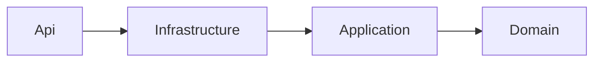
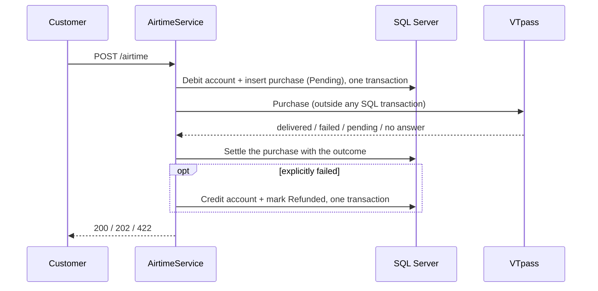

# AnchorBank

A small banking API I built to get properly comfortable with ASP.NET Core. You can register, log in, open accounts, deposit, withdraw, move money between accounts, send money to another bank and buy airtime through the VTpass sandbox.

It started as a CRUD exercise and turned into a study of the interesting part of banking software: what happens when money moves and something goes wrong halfway.

Two of these run side by side: **AnchorBank is bank A** and **BridgeBank is bank B**. Separate repos, separate databases, the same code, and an interbank API between them guarded by a shared secret and an allowed address list.

## What I wanted to get right

- **Money moves atomically.** A debit without its matching record, or a transfer that only half happens, should be impossible.
- **Never guess about money.** When an outside provider times out, I don't know if the airtime was delivered, so the code doesn't pretend to know. It only refunds when the provider says it failed.
- **Ownership can't be bypassed.** Asking for someone else's account looks the same as asking for one that doesn't exist.
- **A payment can't happen twice.** Every transfer and airtime purchase carries a reference from the client, and the database refuses to use one twice, so a retry that arrives after a timeout returns the original answer instead of moving the money again.
- **The other bank doesn't get my provider keys.** BridgeBank (bank B) has no VTpass credentials at all; when its customers buy airtime, it asks bank A to buy it.

## Built with

.NET 10 and ASP.NET Core controllers, SQL Server 2022 (in Docker) through Dapper, JWT auth with PBKDF2 password hashing, and xUnit. No EF Core. The airtime provider is the VTpass sandbox.

## How it's organised

Four projects, with dependencies pointing inward only:



```
AnchorBank.Api/             controllers, auth wiring, Swagger
AnchorBank.Application/     services, request records, interfaces
AnchorBank.Domain/          entities, enums, and the business rules
AnchorBank.Infrastructure/  Dapper repositories, SQL scripts, the VTpass and interbank clients
```

There's one test project per layer, plus one that boots the whole API.

The airtime provider is a good example of why the layers are split this way. The contract (`IAirtimeProvider`) lives in Application and `VtpassService` implements it in Infrastructure. The business logic never sees VTpass's JSON, and switching providers only touches Infrastructure.

The same code also runs as a second bank, BridgeBank, with a different bank code, port and database. Wiring that one's `IAirtimeProvider` to a client of this bank's interbank endpoint was the whole change on its side.

## Try it in a few minutes

Once it's running (setup is below), open Swagger and follow this path:

1. Register a customer and log in. Copy the `accessToken`.
2. Click **Authorize** and paste the token (just the token, see the gotcha below).
3. Create an account and deposit some money into it.
4. Buy airtime with `08011111111`. This is the VTpass sandbox's success number, so you get `200`.
5. Buy again with `08022222222`. The sandbox treats any other number as a failure, so you get `422`, the money is refunded, and the transaction list shows the debit followed by the credit.

## Getting started

### You'll need

- The .NET 10 SDK
- Docker, for SQL Server 2022
- A [VTpass](https://www.vtpass.com) sandbox account, with the airtime products whitelisted under your Sandbox profile's Product Settings. Skip this and VTpass answers with code `028`.
- For the interbank endpoints, a second bank running on `https://localhost:7177`. BridgeBank is the one this repo was tested against, and it needs this bank running to do its airtime.

### 1. Database

Start SQL Server in Docker, create a database called `AnchorBank`, then run the scripts in `AnchorBank.Infrastructure/Database/Scripts` in numeric order.

### 2. Secrets

The connection string and keys aren't in the repo. They go in user secrets:

```bash
dotnet user-secrets set "Jwt:SigningKey" "<at least 32 characters>" --project AnchorBank.Api
dotnet user-secrets set "ConnectionStrings:DefaultConnection" "Server=localhost,1433;Database=AnchorBank;User Id=sa;Password=<password>;TrustServerCertificate=True;" --project AnchorBank.Api
dotnet user-secrets set "Vtpass:ApiKey" "<sandbox api key>" --project AnchorBank.Api
dotnet user-secrets set "Vtpass:SecretKey" "<sandbox secret key>" --project AnchorBank.Api
dotnet user-secrets set "Interbank:PeerSecret" "<shared with the other bank>" --project AnchorBank.Api
```

The settings that aren't secret live in `appsettings.json`: JWT issuer and audience, the VTpass base URL, this bank's code, the peer's code and base URL, and the addresses allowed to call `/api/interbank`.

### 3. Run

```bash
dotnet run --project AnchorBank.Api
```

Then open <https://localhost:7176/swagger>.

> **A gotcha worth knowing:** paste only the token into Swagger's Authorize box. The document already declares the bearer scheme, so typing `Bearer` in front sends `Bearer Bearer eyJ...` and every call comes back `401 invalid_token`. It looks like a bug in your own auth code, and it isn't.

## Endpoints

Register and login are public and rate limited (5 registrations per 10 minutes, 5 logins per minute). Everything else needs the token.

| Method | Path | What it does |
|---|---|---|
| POST | `/api/auth/register` | Create a customer |
| POST | `/api/auth/login` | Get an access token |
| POST | `/api/account` | Open an account (the owner comes from the token, not the body) |
| GET | `/api/account` | List my accounts |
| GET | `/api/account/{id}` | One of my accounts |
| GET | `/api/account/{id}/balance` | Balance |
| GET | `/api/account/{id}/transactions?page=1&pageSize=20` | Transaction history |
| POST | `/api/account/{id}/deposit` | Deposit |
| POST | `/api/account/{id}/withdraw` | Withdraw |
| POST | `/api/account/{sourceId}/transfers` | Transfer to another account here, or to another bank with `destinationBankCode` |
| POST | `/api/account/{id}/airtime` | Buy airtime |
| POST | `/api/interbank/credits` | Another bank pays money into an account here |
| POST | `/api/interbank/airtime` | Another bank asks this bank to buy airtime |
| GET | `/api/customer/{id}` | My own record |

Ownership is a `WHERE` clause in the queries, not a check in a service. That's why someone else's account gives a `404` and not a `403`: it simply isn't visible to you.

The two interbank paths don't take a JWT, because the caller is a bank and not a customer. They check two things: the caller's address is in `Interbank:AllowedCallers`, and it sends the shared secret in `X-Bank-Secret`. Anything else gets `403` or `401` before the action runs.

## How money moves

Deposits, withdrawals and transfers each run in a single SQL transaction: lock the account rows with `UPDLOCK, ROWLOCK`, check the locked values, update, write the transaction row, commit.

A transfer locks both accounts in one query, ordered by `Id`. Without that ordering, two transfers in opposite directions deadlock each other. I only truly believed it once the concurrency test failed without it.

### Sending money to the other bank

An interbank transfer can't be one transaction, because half of it happens in someone else's database. So the debit and a `Pending` transfer row are committed first, and only then is the other bank called. If it accepts, the row becomes `Completed`. If it refuses (account not found, inactive), the amount is refunded, a reversal transaction is written and the row becomes `Failed`. If it doesn't answer at all, you get `502` and the row stays `Pending` with the money debited — the honest state, since the money may well have arrived.

A retry with the same `clientReference` resends the *stored* amount and destination rather than the request's, and the receiving bank's own record of `(sending bank, account, reference)` stops it crediting twice. That's the part I care most about: the sender can safely retry, because the receiver is the one that enforces once-only.

## Buying airtime



The account is debited and the purchase row saved **before** VTpass is called, so there's always a record with its `request_id`, whatever happens next. The call itself sits outside any SQL transaction. Otherwise a slow provider would hold a lock on the customer's account for up to 30 seconds, and a crash would erase the only evidence that a request might have gone out.

### Reading VTpass's answer

VTpass can return code `000` for several different states, so the code that matters is the inner `content.transactions.status`:

| VTpass says | Means | Purchase becomes |
|---|---|---|
| `delivered` | It worked | Success |
| `failed`, `reversed` | It definitely didn't | Failed, then Refunded |
| `pending`, `initiated` | Still working on it | Processing |
| anything else, unreadable JSON, a timeout, a network error | We don't know | Unknown |

The rule behind the table is that **only an explicit failure refunds**. A timeout doesn't mean the airtime wasn't delivered, so refunding on one could hand a customer their money back *and* their airtime. That's why `Unknown` exists as its own state, and why a connection failure comes back as `Unknown` instead of throwing. It also catches code `028`, which has no transaction object at all.

### The purchase lifecycle

| Status | Meaning |
|---|---|
| Pending | Saved and debited; the provider hasn't answered yet |
| Processing | The provider says it's in progress |
| Unknown | No usable answer |
| Success | Delivered (final) |
| Failed | The provider said no, so a refund is owed |
| Refunded | Money returned (final) |

The entity enforces the transitions: `Pending`, `Processing` and `Unknown` can move to `Success` or `Failed`, only `Failed` can move to `Refunded`, and `Success` and `Refunded` can never change again. The refund also updates `WHERE Status = Failed` and checks the affected row count, so the same purchase can't be refunded twice.

### What the endpoint returns

`POST /api/account/{id}/airtime`

```json
{ "network": 1, "phoneNumber": "08011111111", "amount": 100 }
```

`network` is `1` for MTN, `2` for Glo, `3` for Airtel and `4` for Etisalat (9mobile).

| Status | Meaning |
|---|---|
| `200` | Delivered |
| `202` | Still processing or unknown; the money stays debited until it's resolved |
| `422` | Failed and refunded |
| `409` | Insufficient funds, or the account isn't active |

### Airtime for the other bank

BridgeBank has no VTpass keys, so it asks this bank: `POST /api/interbank/airtime` with its own request id. `InterbankAirtimeService` buys with this bank's credentials and records the result in `InterbankAirtimeRequests`, keyed on the asking bank and that request id, so a retry can't buy twice. The answer carries the purchase status, and the other bank settles its own customer from it — it holds the money, so it does the refunding.

What this doesn't do is settle between the banks. This bank pays VTpass out of its own wallet and the other bank keeps its customer's payment. A real scheme squares that up afterwards.

## When something goes wrong

| You see | Likely cause |
|---|---|
| `401 invalid_token` in Swagger | A leftover `Bearer ` prefix, an expired token, or a changed `Jwt:SigningKey`. Check the `www-authenticate` response header for the exact reason. |
| `400` mentioning "11 digits starting with 0" | The phone number isn't in quotes in your JSON. `"08011111111"` is a string, but `08011111111` is an invalid number. |
| VTpass code `028` | The product isn't whitelisted on your sandbox account. Turn it on in Product Settings. |
| "No such host is known" | Your machine can't resolve `sandbox.vtpass.com`. Check your network, DNS or VPN. |
| `202` where you expected `200` | The purchase landed in `Processing` or `Unknown`. Look at `ProviderMessage` on the `AirtimePurchases` row. |
| `401` or `403` on `/api/interbank/...` | The caller's address isn't in `Interbank:AllowedCallers`, or its `X-Bank-Secret` doesn't match `Interbank:PeerSecret`. |
| `502` from a transfer | The other bank didn't answer. The money is still debited and the transfer is `Pending`; retry with the same `clientReference`. |
| `400` "Unknown destination bank" | `destinationBankCode` is neither this bank's code nor the configured peer's. |

## Tests

```bash
dotnet test AnchorBank.slnx
```

- **Domain** tests cover the entity rules, including which airtime statuses may follow which.
- **Application** tests use hand-written fakes, since there's no mocking library in the solution.
- **Infrastructure** tests hit a real SQL Server. The fixture creates and drops `AnchorBankTests` from the scripts, so a new script is picked up automatically.
- **API** tests boot the real pipeline with `WebApplicationFactory` and mint tokens directly, which keeps the login rate limiter out of the way.

The VTpass client is tested with a fake `HttpMessageHandler` against JSON captured from the sandbox: one real success and one real failure. The interbank guard is tested as middleware directly with a `DefaultHttpContext`, because the in-memory test host has no caller address for the allow-list to check.

## What's next, and what's missing

- **Reconciliation.** A purchase that ends up `Processing` or `Unknown` just sits there. `RequeryAsync` exists on the provider interface, but nothing runs it yet. A background worker, ideally fed by a queue, is the natural next step, and it would also take the provider call off the request path.
- **Pending interbank transfers need a nudge.** If the other bank stays down, the transfer sits `Pending` with the money debited and nothing resolves it on its own. There's no requery and no background worker, so clearing those rows is a manual job today.
- **Settlement between the banks.** Airtime bought for the other bank's customers is paid by this bank and never squared up.
- **The peer is configured, not discovered.** One peer, its address and a shared secret in settings; no bank directory.
- **Data purchases**, which would reuse most of the airtime machinery.
- **Idempotency keys on deposits and withdrawals.** Transfers and airtime have them; the two simple money endpoints still don't.
- **Refresh tokens.**
- **Test gaps.** Nothing exercises `AirtimeService` end to end, and the double-refund guard is only proven by reading the code.
